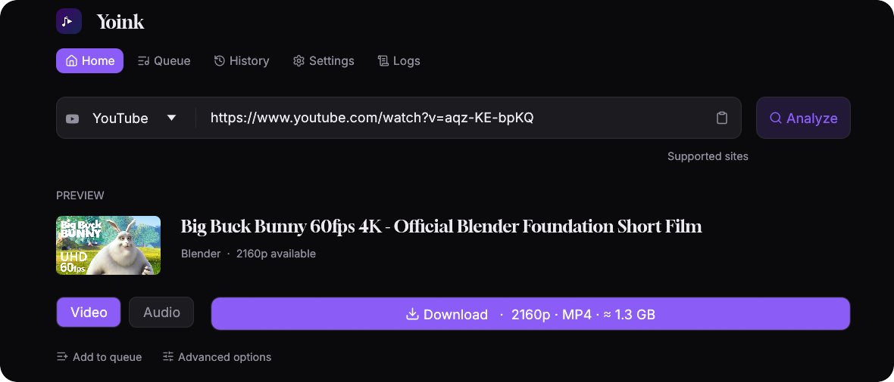

# Yoink Media Downloader

[](https://github.com/ayozetr/yoink-app/releases/latest)


[](https://github.com/ayozetr/yoink-app/releases/latest)



Yoink is a local desktop application for downloading high-fidelity video and
audio from roughly 1,800 sites. It provides a clean user interface over
[yt-dlp](https://github.com/yt-dlp/yt-dlp) and [ffmpeg](https://ffmpeg.org/):
paste a link (or an entire Spotify or YouTube playlist), choose a format, and
download it with real previews, live progress and automatic music tagging.
Nothing leaves the machine except the download itself — no account, no
telemetry, no cloud service.

## Features

### Downloading

- Paste any URL, or search directly from the input field, and preview the real
  available formats. A source toggle searches YouTube or SoundCloud.
- Video in MP4, MOV or MKV (with optional subtitles and chapters) or audio in
  MP3, M4A, FLAC or WAV, up to 4K.
- Trim a clip to a range, save format presets, and follow live progress (speed
  and ETA, with cancel and retry).
- VR 180°/360° content is detected and tagged so headset players such as Quest,
  DeoVR and Heresphere render it in 3D.

### Music

- Import from Spotify, Deezer, Apple Music, Tidal or Amazon without an account.
  Yoink finds the closest YouTube match and tags it with the exact source
  metadata and cover art.
- Auto-tag audio downloads (artist, album, cover) from Apple Music, Deezer or
  MusicBrainz, with a review step before anything is written.
- Optional lyrics (via LRCLIB) and loudness normalization to -14 LUFS.

### Batches and library

- Playlists and a paste-many queue: select items, download them in order,
  resume after a crash, and reorder or skip live. Playlist sync pre-selects only
  the entries that are new.
- A local history and statistics store (SQLite), with re-tagging, cover art and
  one-click file access.

### The application

- A self-contained desktop app (Tauri, for Linux and Windows) that bundles the
  backend and ffmpeg, so there is nothing else to install.
- 14 interface languages, a dark theme, system tray with launch-at-startup,
  global shortcuts, desktop notifications, automatic updates, SponsorBlock, and
  cookie and proxy support.
- Browser integration through a `yoink://` deep link and the "Send to Yoink"
  (beta) extension, which hands off the current page with a right-click:
  [Firefox](https://addons.mozilla.org/firefox/addon/send-to-yoink/) and
  [Chrome](https://chromewebstore.google.com/detail/ccbngfpojjboddajeialdgppooagdhkp).

## Installation

Download the installer for your operating system from the
[latest release](https://github.com/ayozetr/yoink-app/releases/latest) — Linux
(AppImage, deb, rpm) or Windows (msi, NSIS). The application is self-contained
(no Python, yt-dlp or ffmpeg to install separately) and updates itself.

## Running from source

```bash
python scripts/setup.py    # one-time: cargo build (backend) + npm install (frontend)
python scripts/dev.py      # run the backend (:8756) and frontend (:5173) together
```

Then open <http://localhost:5173>. For development you need `yt-dlp` on your PATH
and ffmpeg (the packaged app bundles both). See [`CLAUDE.md`](CLAUDE.md) for
per-layer commands.

### Desktop build (Tauri)

```bash
bash scripts/build_ffmpeg.sh      # one-time: build a minimal ffmpeg + ffprobe (~33 MB)
python scripts/build_core.py      # build yoink-core, fetch yt-dlp, assemble the bundle
npm run tauri build               # installers in src-tauri/target/release/bundle
```

Prerequisites: the Rust toolchain and, on Linux, `webkit2gtk` (4.1); on Windows,
WebView2 and the MSVC build tools. The full process is documented in
[`docs/releasing.md`](docs/releasing.md).

## Architecture

Yoink has two layers that communicate asynchronously: a React, TypeScript and
Tailwind frontend, and a local native Rust backend (`yoink-core`, built on axum)
that drives `yt-dlp` and `ffmpeg`. Metadata is fetched over REST
(`POST /api/info`) and downloads are streamed live over a WebSocket
(`/api/ws/download`).

```
src/                      # frontend (React, TypeScript, Tailwind)
├── components/{layout,ui}
├── features/
│   ├── autotag/          # catalogue tagging cards (single and playlist batch)
│   ├── music/            # music-service import card (Spotify/Deezer/Apple/Tidal/Amazon)
│   ├── downloader/       # URL input and source selector, preview, playlist, progress
│   ├── queue/            # download queue (format picker, groups, skip/reorder)
│   ├── history/          # download history and statistics
│   └── settings/         # settings (download dir, defaults, cookies, theme, updates)
├── lib/                  # API client and download WebSocket
└── types/                # shared domain types (the backend JSON contract)

backend-rs/               # native Rust backend (yoink-core); see CLAUDE.md
src-tauri/                # Tauri desktop shell
extension/                # "Send to Yoink" (beta) browser extension (Firefox, Chromium)
scripts/                  # setup.py, dev.py, build_ffmpeg.sh, build_core.py
e2e/                      # Playwright end-to-end tests
```

## Contributing

Issues and pull requests are welcome. See [`CONTRIBUTING.md`](CONTRIBUTING.md)
for how to propose a change and the checks to run before submitting.

## License

Yoink's own source code is licensed under the GNU Affero General Public License,
version 3.0 or later (AGPL-3.0-or-later); see [`LICENSE`](LICENSE). You are free
to use, study, modify and redistribute it, including commercially, provided that
derivative works remain under the AGPL and their source remains available —
including to anyone who interacts with a modified version over a network.
Copyright © 2026 Ayoze Torres. Bundled third-party components retain their own
licenses (ffmpeg under the LGPL, yt-dlp under the Unlicense); see
[`docs/THIRD_PARTY_LICENSES.md`](docs/THIRD_PARTY_LICENSES.md).

## Disclaimer

Yoink is a personal tool for downloading media that you are entitled to access —
content you own, that is in the public domain, that is openly licensed, or that
you have the rights holder's permission to download. It is not intended for
piracy or copyright infringement. By using it, you accept that you alone are
responsible for how you use it and for complying with all applicable laws and
platform terms. The full text is in [`DISCLAIMER.md`](DISCLAIMER.md).

## Documentation

- [`CLAUDE.md`](CLAUDE.md) — high-level guide and conventions
- [`CONTRIBUTING.md`](CONTRIBUTING.md) — how to contribute
- [`docs/`](docs/) — architecture, per-layer guides, the
  [roadmap](docs/ROADMAP.md), the [release process](docs/releasing.md) and
  the [third-party licenses](docs/THIRD_PARTY_LICENSES.md)
